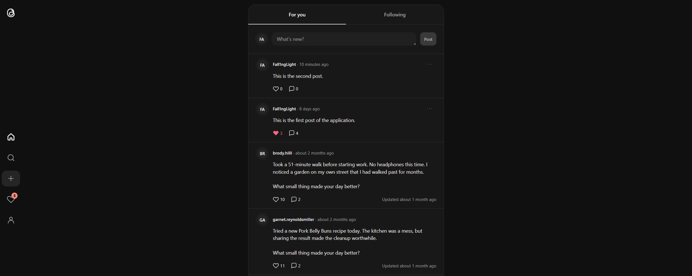
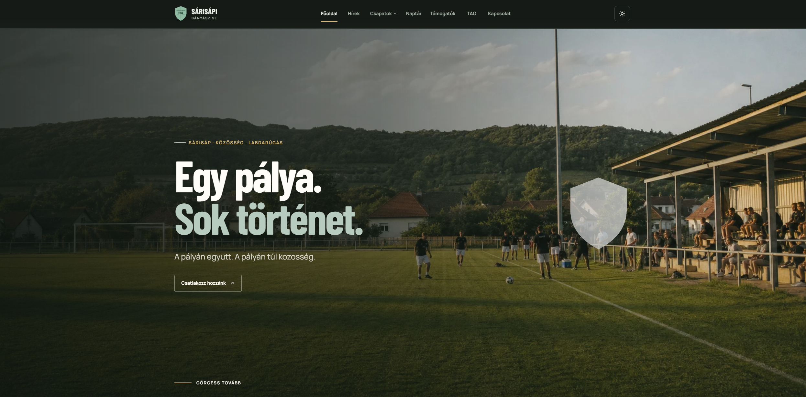

# 👋 Hi There!

Welcome to my GitHub profile!

I build web applications with C#/.NET and Vue, with a particular interest in backend development.

During a two month internship at Aximmetry Technologies I worked on WinForms UIs of virtual production software using C#/.NET.

My main project is Threads.clone, a full-stack social application with public and private profiles, follow requests, blocking, and notifications. Furthermore, a Github Actions powered CI/CD pipeline handles automated unit, integration tests and deploys to Azure.

Currently, I’m pursuing a BSc Computer Science degree at Óbuda University, where my thesis focuses on analysing table tennis techniques using computer vision.

I’m looking for a software development internship or part-time job with a focus on backend or full-stack development.

---

### 📫 Contacts

- Email: kerulo.szabolcs.dev@gmail.com
- LinkedIn: [Szabolcs Kerülő](https://www.linkedin.com/in/szabolcs-kerülő-b1a871166)

---

## Projects

<table align="center">
  <thead>
    <tr>
      <th align="center">Name</th>
      <th align="center">Technologies</th>
    </tr>
  </thead>
  <tbody>
    <tr>
      <td align="center"><strong><a href="https://github.com/Fall1nglight/Threads.clone">Threads.Clone</a></strong></td>
      <td align="center"><code>C#/.NET</code>, <code>Vue</code>, <code>TypeScript</code>, <code>PostgreSQL</code></td>
    </tr>
    <tr>
      <td align="center"><strong><a href="https://github.com/Fall1nglight/sarisap-bse-football-club">Sárisápi football club's website</a></strong></td>
      <td align="center"><code>Nuxt</code>, <code>Vue</code>, <code>TypeScript</code>, <code>Netlify</code></td>
    </tr>
    <tr>
      <td align="center"><strong><a href="https://github.com/Fall1nglight/uni-dsa-course">uni-dsa-course</a></strong></td>
      <td align="center"><code>C#/.NET</code>, <code>NUnit</code></td>
    </tr>
  </tbody>
</table>

---

## Gallery

---

## Languages

  
  
  
  
  
  
  
  
  
  
  

## Technologies

  
  
  
  
  
  
  
  
  
  
  
  
  
  
  
  
  
  
  
  
  

---
